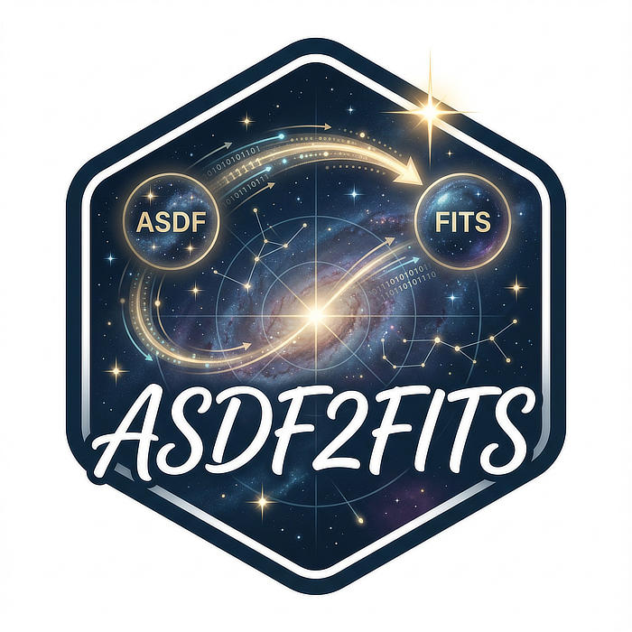

<p align="center">
  
</p>

# asdf2fits

Load [ASDF](https://www.asdf-format.org/) files as [DeepSkyFits](https://gitlab.in2p3.fr/deepskyproject/deepskyfits)
objects, and save those objects back to ASDF. Built on the
[libasdf](https://github.com/asdf-format/libasdf) C library.

```c++
#include <asdf2fits/ASDFmanager.h>
#include <asdf2fits/fits2asdf.h>
using namespace DSL;

ASDFmanager file("observation.asdf");

// Metadata only: no pixel or table data is read
std::shared_ptr<FITShdu> header = file.GetHeader("SCI");
double exptime = header->GetDoubleValueForKey("EXPTIME");

// Data, by name or by index (the first HDU is 1, as in FITSmanager)
std::shared_ptr<FITScube>  image = file.GetImage("SCI");
std::shared_ptr<FITStable> table = file.GetTable("CATALOG");
auto typed = std::dynamic_pointer_cast<FITSimg<float>>(image);  // FITSimg<T>, like any FITScube

image->Write("sci.fits");                                       // the DeepSkyFits API applies as usual

// Saving
fits2asdf(*image, "image.asdf");                                // as the primary HDU
fits2asdf(*table, "table.asdf", /*replace=*/true);              // after an empty primary HDU

FITSmanager fits("observation.fits");
fits2asdf(fits, "observation.asdf");                            // every HDU of a FITS file
```

Failures throw `FITSexception`.

## What is read

| In the ASDF file | Becomes |
|---|---|
| Value tagged `.../fits/fits-*` (astropy FITS layout) | One HDU per list entry, with its exact header |
| ndarray of a numeric type | `ASDFimg<T>`, a `FITSimg<T>` keeping the tree (`float16` as `float`, `bool8` as `uint8_t`) |
| Structured ndarray, or value tagged `.../table-*` | `FITStable` |
| Scalars next to an ndarray | Keywords of its HDU, nested keys as `META.INSTRUMENT.NAME` |
| Scalars at the root of the tree | Keywords of the primary HDU |

- Without the FITS layout, an HDU is named after its tree path. The one called `PRIMARY`, or else the first found,
  is the primary HDU.
- Axes are reversed to follow FITS: an array of shape `[ny, nx]` has `NAXIS1 = nx`.
- Values are physical, so `BSCALE`/`BZERO` found in a header are not applied.
- NaN (real images) and the `BLANK` value (integer images) mark masked pixels.
- The FITS WCS is loaded from the header keywords.

Not converted:

- GWCS objects (Roman, JWST) don't become FITS keywords: an `ASDFimg` uses them for its world coordinates (see
  [World coordinates](#world-coordinates-gwcs)), and they are written back as they were.
- Table columns that aren't plain ndarrays (`Time`, `Quantity`, `SkyCoord`) are left out.
- Complex and string images, and ndarray `mask` properties, which libasdf doesn't read.
- Strided tables, which throw.

## ASDF images

Images are `ASDFimg<T>`: `FITSimg<T>` images that also keep the tree of their file, so the code written for FITS
images takes them as they are, and what ASDF holds beyond a FITS header isn't lost. Code that knows only
`FITScube` reaches the ASDF side with `std::dynamic_pointer_cast<ASDFcube>`.

```c++
#include <asdf2fits/ASDFmanager.h>
using namespace DSL;

ASDFmanager file("r0000101001001001001_0001_wfi01_f158_cal.asdf");
std::shared_ptr<FITScube> image = file.GetImage("roman.data");  // only these pixels are read
auto asdf = std::dynamic_pointer_cast<ASDFcube>(image);

// The tree: nested values, with their YAML tags (times, units, GWCS...)
const ASDFnode& start = asdf->Meta().At("roman/meta/exposure/start_time");
std::string when = start.Get<std::string>();                    // start.Tag(): .../time/time-1.4.0
asdf->Set("roman/meta/instrument/name", ASDFnode("WFI"));       // tree and header together

// The header is a flat view of the tree, for FITS tools; changes made to it go back to the tree
image->HDU().ValueForKey("META.EXPOSURE.EXPOSURE_TIME", 140.);

// The arrays next to the image: handles that read nothing until asked
std::shared_ptr<ASDFarray> err = asdf->Companion("err");        // err->Shape(), err->DataType(): no reading
asdf->MaskFromDQ(1);                                            // reads dq, masks, frees dq
double e = err->ValueAt({100, 200});                            // one element
auto tile = err->Read({0, 0}, {256, 256});                      // one tile, kept by nobody

// Cut: the companions of the same shape are cut too, still without being read
auto cut = image->Window(1000, 1000, 512, 512);
auto part = file.GetImageWindow("roman.data", {1000, 1000}, {512, 512});    // reads only those pixels

// Writing: the whole file, in its own layout, with a history entry for each change
ASDFwriteOptions options;
options.compression = "zlib";                                   // of what is written from memory
options.history = "background subtracted";
std::dynamic_pointer_cast<ASDFcube>(cut)->WriteASDF("cut.asdf", options);
```

- **Tree.** `ASDFnode` holds every value of the tree with its tag, mappings in file order. Paths join keys and
  indices with `/`. `ASDFmanager::GetTree()` returns the whole tree without reading any array, and
  `WriteASDF(tree, path)` writes one, for example after changing only metadata. `ASDFmanager::GetPathAtIndex()`
  tells where an HDU is in that tree: the subtree it is read from (`roman`, or `fits/0` in the astropy FITS layout)
  and its data (`roman/data`).
- **Header.** The header of an image is built from the tree as before (`META.INSTRUMENT.NAME`). A keyword changed
  in the header updates the value it was read from, keeping its tag; a removed one removes it; a new one goes
  next to the image, a dotted name `A.B` as the mappings `a/b`. The structure keywords (`BITPIX`, `NAXISn`,
  `BSCALE`...) follow the pixels and never reach the tree. After changing `Meta()` directly, call `RefreshHDU()`.
- **Companions.** When the image is in a mapping of its own, as in the Roman and JWST data models, the other
  ndarrays of that mapping are its companions. An `ASDFarray` handle knows its shape, type, size and compression
  without reading; `Load()` reads it (only its view) and keeps it, `Release()` frees it, `Read()` reads a tile and
  keeps nothing. A handle keeps its file open, even after the manager is closed.
- **Changes of shape.** `Window()`, `Resize()` and `Layer()` cut the companions of the image's shape the same way,
  as views that read nothing until loaded. `Rebin()`, `Overlay()`, `AddLayer()` and any other change of shape drop
  them: err or dq can't be combined like pixels. A window of a 2D image shifts its GWCS to the window; any other
  change of shape removes the GWCS objects next to the image, which would no longer match it. The FITS WCS of the
  header is kept up to date by `FITSimg`.
- **Results.** Processing code that builds plain `FITSimg<T>` results gives them the tree back with
  `asdfLike(result, *asdf, "what was done")`, which drops the companions of the image's shape.
- **Writing.** `WriteASDF()` writes the whole tree: the image and the loaded arrays from memory, the arrays not
  loaded copied from their file block by block, still compressed, without being decompressed. Values asdf2fits
  doesn't interpret (GWCS, units, times, transforms) come back unchanged, and so do the history entries of the
  file, with one more for each change recorded. Compression applies to what is written from memory: `"keep"` (the
  original one, by default), `""`, `"zlib"`, `"bzp2"` or `"lz4"`. The file is written under a temporary name and
  renamed, so writing over the file the image was read from is safe. `fits2asdf()` does the same for an `ASDFimg`.
- **Large files.** `ASDFreadOptions::maxMemoryBytes` makes libasdf decompress larger arrays to a temporary file
  rather than to memory.

Not supported: YAML anchors are read, but each alias is written as a copy of what it points to; `float16` and
`bool8` companions that are loaded are written back as `float32` and `uint8`.

### World coordinates (GWCS)

The GWCS of an image is the first GWCS object next to it, such as `roman/meta/wcs` for `roman/data`.
`ASDFimg<T>` overrides the WCS methods of `FITScube` with it, so code written for FITS images, the FitsViewer
among them, uses it without knowing:

```c++
std::shared_ptr<FITScube> image = file.GetImage("roman.data");
worldCoords sky   = image->WorldCoordinates(pixelCoords{100., 200.});   // GWCS: 0-based pixels, degrees
pixelCoords pixel = image->World2Pixel(sky);

auto gwcs = std::dynamic_pointer_cast<ASDFcube>(image)->GWCS();        // null if none, or unusable
gwcs->Frames();                                                         // detector, v2v3, ..., world
gwcs->Convert("v2v3", "world", {v2, v3});                               // between any two frames
```

- **Transforms.** A GWCS is a chain of frames linked by transforms, read by `ASDFtransform::Read()`. Each kind of
  transform is a class derived from `ASDFtransform`, built by a builder registered under the name of its tag. The
  library knows `compose`, `concatenate`, `add`/`subtract`/`multiply`/`divide`/`power`, `shift`, `scale`,
  `multiplyscale`, `identity`, `remap_axes`, `constant`, `polynomial` (1D and 2D, with domain and window),
  `affine`, `rotate_sequence_3d`, `gnomonic`, `rotate3d` (native/celestial) and gwcs's `spherical_cartesian`:
  enough for the imaging GWCS of Roman and JWST.
- **A new kind of transform** is added by deriving a class and registering its builder, without changing the
  library. A GWCS using a kind not registered can't be used: `GWCS()` gives null, with a warning naming the kind,
  and the FITS WCS of the header, if any, is used instead.

  ```c++
  class Square : public ASDFtransform
  {
  public:
      Square(): ASDFtransform(1, 1) {}                                  // inputs, outputs
      void Evaluate(const double* in, double* out) const override { out[0] = in[0] * in[0]; }
  };
  ASDFtransform::Register("transform/square", [](const ASDFnode& node) { return std::make_shared<Square>(); });
  ```

  Parameters are read from the node with `ASDFtransform::Number()`, `Numbers()` (ndarrays, lists, quantities)
  and `Operands()` (the transforms under `forward`). A class that knows its inverse overrides `AnalyticInverse()`.
- **Inverses.** World to pixel uses the inverse the file gives (`inverse:` of a transform), otherwise the one the
  transform gives itself (a shift, a scale, a rotation, a composition of those...). If a step has neither, the
  pixel is found by Newton's method. As in gwcs, an inverse given by the file is used as it is: the distortion
  inverses of JWST and Roman are fitted polynomials, good to a few hundredths of a pixel. An inverse whose number
  of inputs or outputs doesn't fit its transform (astropy writes some, never used) is ignored.
- **Bounding box.** As in gwcs, a pixel outside the bounding box gives NaN, and so does a world position whose
  pixel falls outside it.
- **JWST.** JWST products are FITS files with the GWCS in an `ASDF` extension: not read yet.

## What is written

`fits2asdf` uses the layout of [asdf-astropy](https://github.com/astropy/asdf-astropy)
(`tag:astropy.org:astropy/fits/fits-1.2.0`): a list of HDUs with `header` as `[key, value, comment]` cards, and
`data` as an ndarray. Tables are structured ndarrays, which that schema allows. In Python:

```python
import asdf
with asdf.open("observation.asdf") as f:
    hdul = f["fits"]    # astropy.io.fits.HDUList
```

- Data are written as physical values, so `TSCALn`/`TZEROn` are not carried over.
- Masked pixels become NaN, or a `BLANK` value for integers (the lowest value of a signed type, the highest of an
  unsigned one).
- Variable-length columns (`P`/`Q`) have no ASDF form and throw.

Two limits of astropy's `BinTableHDU` affect tables opened through astropy; plain `asdf` and this library read them
correctly:

- `int8` columns are read as booleans.
- `TUNITn` is ignored, so column units don't show up in `hdul[i].columns`.

## Build

Requires CMake 3.21 or newer, a C++20 compiler, autoconf, automake, libtool, pkg-config, lz4, zlib and bzip2.
On macOS: `brew install cmake autoconf automake libtool pkgconf lz4`.
DeepSkyFits (`DSTfits` 1.5 or newer) must already be installed in `$DeepSkyROOT` (by default, the parent directory).

```sh
git clone --recurse-submodules https://gitlab.in2p3.fr/deepskyproject/asdf2fits.git
cd asdf2fits
cmake --preset default     # or: cmake -S . -B build
cmake --build build -j
ctest --preset default     # or: (cd build && ctest)
cmake --install build      # to $DeepSkyROOT unless CMAKE_INSTALL_PREFIX is set
```

Everything is generated in the build directory: libraries in `build/lib`, the test program in `build/bin`, the
libmd/libfyaml/libasdf builds in `build/external` and `build/stage`. Configuring from the project directory itself
(`cmake .`) is refused. Configuring from inside a directory you created (`mkdir build && cd build && cmake ..`)
works too. `cmake --preset asan` makes a Debug + AddressSanitizer build in `build-asan`.

libasdf and its dependencies libfyaml and libmd are built from the submodules. libasdf is built from a copy in
`build/external/libasdf-src`, with every `cmake/patches/libasdf-*.patch` applied in name order; the submodule itself
stays unmodified. The patches stay until upstream has the fixes:

- [libasdf-document-end-marker.patch](cmake/patches/libasdf-document-end-marker.patch) (`src/parser.c`,
  `parse_tree_fast()`): fixes an endless loop while reading. When the YAML document end marker `...` lay at the end
  of the read buffer, the newline after it wasn't buffered yet, the check failed and the parser scanned again from
  the same place forever; a marker followed by anything but a newline looped the same way. The patch asks the stream
  for the marker and its line ending (`ASDF_YAML_DOCUMENT_END_MARKER_SIZE + 2` bytes), and steps over a match that
  isn't a marker.
- [libasdf-history-entry-time.patch](cmake/patches/libasdf-history-entry-time.patch) (`src/core/history_entry.c`,
  `asdf_history_entry_serialize()`): keeps the `time` of history entries. Each time libasdf writes a file whose
  root is `core/asdf`, it rebuilds `history`: every entry is deserialized, then serialized again, and the
  serializer left `time` out (a TODO upstream). So every write lost the time of every entry, old ones included.
  The patch writes `time` back, between `description` and `software`, as a string holding the text that was
  read (`asdf_time_t::value`), which is what the `history_entry-1.0.0` schema asks for. An entry whose time
  libasdf can't parse still loses it, with a warning from libasdf.

A patch that no longer applies stops the build with a message: if the new libasdf has the fix, delete the patch.
Adding, changing or removing a patch copies and builds libasdf again at the next build. libfyaml and libmd are
linked into `libasdf`, so `libasdf2fits`, `libasdf` and their headers are all that gets installed.
`-DWITH_ASAN=ON` builds with AddressSanitizer.

Some tests need real Roman and JWST files, which are too large for git. They are downloaded on request into
`test/data` (ignored by git), and the tests that need a missing file are skipped:

```sh
cmake --build build --target fetch_samples           # all, ~450 MB
cmake -DSAMPLES=small -P cmake/FetchSamples.cmake    # only the JWST GWCS objects of the gwcs package, ~35 kB
```

| File | What it is |
|---|---|
| `gwcs_nircamwcs.asdf`, `gwcs_miriwcs.asdf` | JWST NIRCam and MIRI imaging GWCS objects, without pixels (gwcs test data, pinned commit) |
| `roman_wfi01_f106_cal.asdf` | Simulated Roman WFI L2 image (romancal 0.18) with its GWCS in `meta/wcs`; `meta/wcsinfo/s_region` gives the sky position of the corners |
| `jwst_nrcb1_cal.fits` | JWST NIRCam L2 image (program 2736); GWCS in the `ASDF` extension, TAN-SIP approximation in the SCI header |

Each file is checked against its SHA-256, and one already there isn't downloaded again.

To use the library from CMake:

```cmake
find_package(DSTfits 1.5 REQUIRED)
find_package(asdf2fits REQUIRED)
target_link_libraries(myapp asdf2fits::asdf2fits DSTfits::DSTfits)
```

## License

asdf2fits is licensed under the [BSD 3-Clause License](LICENSE), the same terms as libasdf. Copyright (c) 2026 William Gillard.

The code was written by Claude, Anthropic's AI model, for William Gillard, who directed the project and is its licensor.

This licence covers the code of asdf2fits only:

- asdf2fits requires [DeepSkyFits](https://gitlab.in2p3.fr/deepskyproject/deepskyfits), which has its own licence, the PolyForm Noncommercial License 1.0.0. That licence still applies to DeepSkyFits when it is used with asdf2fits.
- The submodules libasdf, libfyaml, libmd and GoogleTest keep their own licences, found in each one's `LICENSE` or `COPYING` file. The libasdf patches in [cmake/patches](cmake/patches) are under libasdf's licence.

*Logo concept and artwork generated with assistance from Gemini, based on the DeepSkyProject visual identity.*
